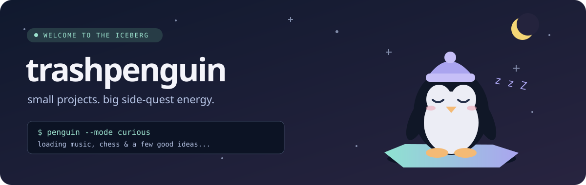

<p align="center">
  
</p>

<h1 align="center">hey, i'm trashpenguin 🐧</h1>
<p align="center"><b>Turning “what if?” into “okay, that actually works.”</b><br />
Music in the terminal. Chess on the board. A few flowers in the browser.</p>

<p align="center">
  <a href="https://github.com/trashpenguin?tab=repositories">Explore my projects</a>
  &nbsp;·&nbsp;
  <a href="https://github.com/trashpenguin/pomme-tui">Meet pomme</a>
  &nbsp;·&nbsp;
  <a href="https://github.com/trashpenguin/IHaveSomethingForYou">Something for you</a>
</p>

---

### Pick a side quest

| Quest | What's inside |
| :--- | :--- |
| **[pomme-tui](https://github.com/trashpenguin/pomme-tui)** | Apple Music in your Windows terminal, with synced lyrics, artwork, and native playback. **Rust** |
| **[Chess Engine](https://github.com/trashpenguin/Chess-Engine)** | A chess engine project built around C/C++ and a 2D board. **C** |
| **[I Have Something For You](https://github.com/trashpenguin/IHaveSomethingForYou)** | Animated flowers for when a plain text message won't do. **HTML · CSS · JavaScript** |
| **[seanime-extensions](https://github.com/trashpenguin/seanime-extensions)** | Custom manga providers for Seanime. One more chapter? **JavaScript** |

### Useful things, too

- **[Contractor Search](https://github.com/trashpenguin/contractor-search)** — multi-source contractor discovery and enrichment, built with Python.
- **[Answer Sheet Generator](https://github.com/trashpenguin/answer-sheet-generator)** — customizable, printable answer sheets for Philippine schools, all in one HTML file.

### In the inventory

<p>
  
  
  
  
  
  
</p>

<details>
<summary>Inspect the penguin</summary>

```text
      .--.
     |o_o |     species: side-quest collector
     |:_/ |     habitat: somewhere between a terminal and a browser
    //   \ \    loot:    music, chess, manga, and tiny useful tools
   (|     | )   status:  probably thinking of another project
  /'\_   _/`\
  \___)=(___/
```

</details>

---

<p align="center"><sub>Thanks for stopping by. Please don't feed the bugs.</sub></p>
